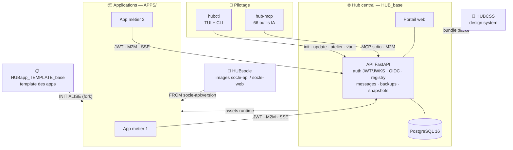

# POULIDOR — Parc applicatif HUB


Plateforme de développement et d'exécution pour applications métier, avec **SSO centralisé**,
**déploiement Docker** et **pilotage unifié**.

**Stack :** FastAPI · React 18 / Vite 5 · PostgreSQL 15 (apps) / 16 (Hub) · Docker Compose

---

## Pourquoi POULIDOR ?

- **SSO maison léger** — authentification JWT/JWKS (RSA asymétrique). Le Hub signe les tokens,
  les apps les vérifient avec une clé publique. Zéro couplage, zéro usine à gaz.
- **Déploiement reproductible** — chaque app est autonome (Docker Compose + Makefile standard)
  et le Hub centralise l'auth, le messaging et les backups.
- **Pilotage unifié** — `./hubctl` (TUI + CLI) administre tout le parc : déploiement,
  configuration, sauvegarde, ateliers de développement, coffre de secrets.

---

## Structure

```
POULIDOR/
├── hubctl                    ← CLI de pilotage (TUI + CLI non-interactif, symlink → hubctl_src)
├── hubctl_src/               ← Code métier hubctl (menu, coffre, atelier, export/restore, socle)
├── HUB_base/                 ← Hub SSO (auth, registry, messaging, backups, OIDC)
├── HUBsocle/                 ← Socle applicatif versionné des apps (factory + images de base)
├── HUBapp_TEMPLATE_base/     ← Template canonique pour toute nouvelle app
├── HUBCSS/                   ← Design system (CSS + icônes + fonts, servi par le Hub)
├── hub-mcp/                  ← Serveur MCP (66 outils IA pour piloter le Hub)
├── APPS/                     ← Vos applications (vide dans la distribution publique — créez les vôtres depuis le template)
├── docs/                     ← Guides du parc (installation, hubctl, make, architecture)
└── exports/                  ← Archives park-export (local, non versionné)
```

## Architecture



### Composants

| Composant | Version | Rôle |
|---|---|---|
| [`HUB_base`](https://github.com/POULIDOR-Audit-Developpement/HUB_base) | 3.61.x | Hub SSO : auth JWT/JWKS, OIDC, registre des apps, messagerie SSE, backups & snapshots, VPN |
| [`HUBsocle`](https://github.com/POULIDOR-Audit-Developpement/HUBsocle) | 2.33.x | Socle versionné des apps : paquets `hub-socle` / `@poulidor/hub-socle`, images de base |
| [`HUBapp_TEMPLATE_base`](https://github.com/POULIDOR-Audit-Developpement/HUBapp_TEMPLATE_base) | 2.35.x | Template canonique dont toute nouvelle app est issue |
| [`Hubctl`](https://github.com/POULIDOR-Audit-Developpement/Hubctl) | 0.16.x | Pilotage du parc : TUI + CLI, ateliers, coffre, PRA |
| [`HUBCSS`](https://github.com/POULIDOR-Audit-Developpement/HUBCSS) | 0.3.x | Design system Tailwind v4 + icônes Lucide, offline-first |
| [`hub-mcp`](https://github.com/POULIDOR-Audit-Developpement/hub-mcp) | 0.4.x | Serveur MCP : 66 outils IA pour administrer le Hub |

Chaque dépôt a son README détaillé (rôle, démarrage, tests) — les versions exactes vivent
dans les fichiers `VERSION` de chaque composant (exception : `HUBCSS` → `package.json`,
`hub-mcp` → son README).

---

## Composants clés

### Hub SSO (`HUB_base/`)
Portail central d'authentification et de service :
- Authentification JWT/JWKS (RSA) — authentification unique pour toutes les apps,
  trousseau multi-clés avec rotation sans rupture
- Provider OIDC complet pour les apps externes (discovery, back-channel logout)
- Registre des applications (découverte M2M)
- Messagerie inter-applications et notifications SSE temps réel
- Sauvegardes automatiques par app + snapshots complets chiffrés du Hub, tableau de
  bord santé des apps
- Support WireGuard VPN intégré

### Template d'application (`HUBapp_TEMPLATE_base/`)
Squelette standard pour toute nouvelle app du parc :
- **Backend** : FastAPI async avec SQLAlchemy 2.x, auth JWT/JWKS, client Hub
- **Frontend** : React 18 + Vite 5, AuthContext avec refresh proactif, TanStack Query
- **Infra** : Docker Compose (PostgreSQL + API + Frontend + Nginx), Makefile standard
- Convention UTC stricte (`TIMESTAMPTZ`, `DateTime(timezone=True)`, `TZ=UTC`)

### Socle versionné (`HUBsocle/`)
Le code de base des apps est mutualisé dans un socle **versionné** :
- Factory `create_app()` (paquet pip `hub-socle`) + frontend `@poulidor/hub-socle` (npm)
- Images de base `poulidor/socle-api` / `poulidor/socle-web` construites en local
  (`./hubctl socle build` — offline-first, aucun registre requis)
- Chaque app déclare sa version via `APP_SOCLE_VERSION` ; `./hubctl socle status`
  surveille le drift de la flotte. Les apps existantes restent des forks du template ;
  les nouvelles apps naîtront « fines » via INITIALISE v2 (à venir).

### Pilotage (`hubctl`)
Outil unique pour administrer tout le parc :
- **TUI interactif** : dashboard avec statut des apps, menus de configuration, coffre de secrets
- **CLI non-interactive** : `start`, `stop`, `update`, `atelier`, `init`, `export`, `restore`, `pra-restore`, `debug`, `vpn`, `vault`, `jwt`, `seed`, `socle`
- **Atelier de développement** : bac à sable par app (`./hubctl atelier <slug>`) — 2e projet compose `<slug>-ws` avec clone de la DB prod, piloté par `APPS/<slug>/.workshop.env` ; `--maj` teste une montée de version, `--prod` déploie ce qui a été validé
- **Coffre chiffré** : sauvegarde des secrets du parc (Fernet + scrypt), export de recovery
- **Park export/restore** : archivage chiffré du parc complet pour disaster recovery

---

## Démarrage rapide

```bash
# 1. Cloner le dépôt
git clone --recurse-submodules https://github.com/POULIDOR-Audit-Developpement/POULIDOR.git
cd POULIDOR

# 2. Installation tout-en-un (prérequis + Hub)
#    Sur Debian/Ubuntu/Linux Mint — installe Docker, Python, git, etc.
#    puis initialise le Hub automatiquement.
sudo ./install.sh

# 3. Le Hub est accessible sur https://<IP_DU_SERVEUR>
#    Les credentials admin s'affichent dans le récapitulatif final.

# 4. Créer une nouvelle application
#    Fichier seed YAML : ./hubctl seed apps.yaml  (ou scripts/create_app.sh)
#    Ou via l'IA : « Crée une app mon-outil dans POULIDOR »
```

### Installation manuelle (alternative)

Si les prérequis sont déjà installés, ou pour un déploiement ciblé du Hub uniquement :

```bash
./hubctl init
```

Voir `HUB_base/docs/GUIDE_INSTALLATION.md` pour l'installation manuelle détaillée.

> 🧰 Outillage dev (gh, tests parallèles, Node.js, diagnostic machine) : [docs/outillage.md](docs/outillage.md)

---

## Mise à jour du parc

⚠️ **Un simple `git pull` ne suffit pas** : les composants (HUB_base, HUBapp_TEMPLATE_base…)
sont des **submodules** — `git pull` ne déplace pas leur pointeur. Et en prod, les fichiers
statiques du frontend sont **cuits dans l'image Docker** (`COPY public/`) : un restart sans
rebuild sert l'ancienne version (badge de version absent, nouveautés invisibles).

### La routine officielle (serveur à jour — installations ≥ 0.74.10, oct. 2026)

Le **méta-repo est la source de vérité** : la commande de mise à jour tire le méta,
aligne les sous-modules, build → up → health check, avec rollback automatique
(pointeur méta + submodule + snapshot DB) en cas d'échec. Le Hub est **bloquant**
dans `update all` : s'il échoue, les apps ne sont pas touchées.

```bash
cd <racine-du-parc>

./hubctl doctor               # 1. diagnostic des clones (rapport seul)
./hubctl doctor --fix         #    si besoin : réalignements sûrs (confirmation, ou --yes)
./hubctl --prod update hub    # 2. le Hub d'abord — BLOQUANT
./hubctl --prod update all    #    ou d'un coup : hub + toutes les apps (hub d'abord)
./hub.sh status               # 3. état des conteneurs + version déployée
```

`./hub.sh update` délègue à `hubctl update hub` ; `update-hub.sh` est **déprécié**.
Mode dev : `--dev` au lieu de `--prod`. Tout existe en `--dry-run`.

### Selon l'ancienneté de votre installation

Les outils de mise à jour ont été mis en place progressivement — la manip dépend
de la version d'où vous partez :

| Installation | La manip |
|---|---|
| **≥ 0.74.10** (unification des updates, oct. 2026) | La routine officielle ci-dessus, directement. |
| **hubctl présent, < 0.74.10** (été → oct. 2026) | `git pull --recurse-submodules && git submodule update --init --recursive` au méta pour récupérer le hubctl récent, **puis** la routine officielle (elle-même utilise `update` tel qu'unifié en 0.74.10). `update-hub.sh` ne doit plus être utilisé. |
| **Pré-hubctl** (< 0.10.0, avant juil. 2026) | `sudo ./install.sh` — il resynchronise les submodules et reconverge le Hub (build + up-prod, cache Docker) même s'il tourne déjà, et met en place `hubctl`. Ensuite, basculez sur la routine officielle. |
| **Cas « historique réécrit »** (purge du 26/10/2026) | `update hub` échoue au pré-check « historique divergent » : réaligner le clone (`git fetch origin --prune && git checkout main && git reset --hard origin/main`) ou le re-cloneur — voir la doc ops. |

> 📖 **La référence complète** : [`docs/ops/mise-a-jour.md`](docs/ops/mise-a-jour.md) —
> rôles de chaque outil (`hubctl`, `hub.sh`, `make`), sémantique d'`update hub`,
> les **interdits** (jamais de `git pull` manuel dans un sous-module, jamais de
> push depuis un clone divergent, jamais de `docker compose down -v`) et le détail
> du cas « historique réécrit ».

---

## Documentation

| Document | Contenu |
|----------|---------|
| `docs/guide-hub/presentation.html` | **Présentation du HUB** — tour d'horizon de toutes les fonctionnalités |
| `docs/guide-hub/hubctl.html` | Guide complet de `hubctl` (TUI + CLI) |
| `docs/guide-hub/make.html` | Référence des commandes `make` par app |
| `docs/guide-hub/architecture.html` | Architecture du parc |
| `docs/guide-parc-poulidor.md` | Référence complète du parc (instantané daté) |
| `docs/cheatsheet-dev-banc.md` | **Banc de test local** : resets (`scripts/banc/`), tokens, debug |
| `docs/guide-developpement-template.md` | Développer une app (conventions, tests, release) |
| `docs/debug-agent.md` | Agent de debug IA |
| `docs/visualDev_guide.html` | Guide visuel (architecture, cycle de vie, atelier, PRA) |
| `docs/canvas-poulidor.html` | Présentation visuelle (canvas client) |
| `HUB_base/docs/GUIDE_ADMIN.md` | Guide administrateur Hub |
| `HUB_base/docs/ARCHITECTURE.md` | Architecture interne du Hub |
| `HUBapp_TEMPLATE_base/docs/API.md` | Conventions API d'une app |
| `HUBapp_TEMPLATE_base/README.md` | Documentation du template |

---

## Compétences IA

Le parc intègre des **skills IA** (`.opencode/skills/`) pour le développement assisté :

| Skill | Usage |
|-------|-------|
| `release-on-main` | Versionnage et CHANGELOG avant push sur `main` |
| `create-hub-app` | Création/scaffold d'une nouvelle app de A à Z |
| `app-workshop-mover` | Cycle atelier : mise en atelier, test, déploiement en prod |
| `migrate-app-template` | Montée de version d'une app vers le template (fusion `.env` incluse) |
| `vault-manager` | Gestion du coffre de secrets chiffré |
| `hub-oidc-manager` | Pont OIDC du HUB : clients, apps externes, debug SSO |

---

## ⚖️ Licence & Modèle Open Source

Ce projet adopte une architecture à **double périmètre de licence** afin de protéger le socle tout en garantissant une liberté totale aux développeurs d'applications métiers :

1. **Cœur du HUB (API, Frontal, Orchestration, VPN, MCP, Console IA)** : Distribué sous licence **[GNU AGPLv3](./LICENSE)**. Vous pouvez l'utiliser, l'auditer et le modifier librement tant que toute version modifiée exposée sur un réseau reste sous licence AGPLv3. Une **licence commerciale** est disponible sur demande auprès de **POULIDOR Audit & Développement**.
2. **Gabarit d'application (`HUBapp_TEMPLATE_base`), SDK M2M & Design System (`HUBCSS`)** : Distribués sous licence permissive **[MIT](./LICENSE-TEMPLATE)**. Les applications métiers que vous développez à partir du gabarit du HUB **ne sont pas soumises à l'AGPLv3** : elles vous appartiennent à 100 % et peuvent conserver la licence de votre choix (y compris propriétaire / code fermé).
3. **Licence Commerciale & Support** : Pour les organisations ou intégrateurs souhaitant intégrer le HUB dans une offre commerciale propriétaire sans les contraintes de l'AGPLv3, ou bénéficier d'un accompagnement officiel (déploiement, audit, MCO), contactez **POULIDOR Audit & Développement**.

*Note : Les noms commerciaux et logos sont soumis à notre [Politique de Marque (TRADEMARK.md)](./TRADEMARK.md).*
