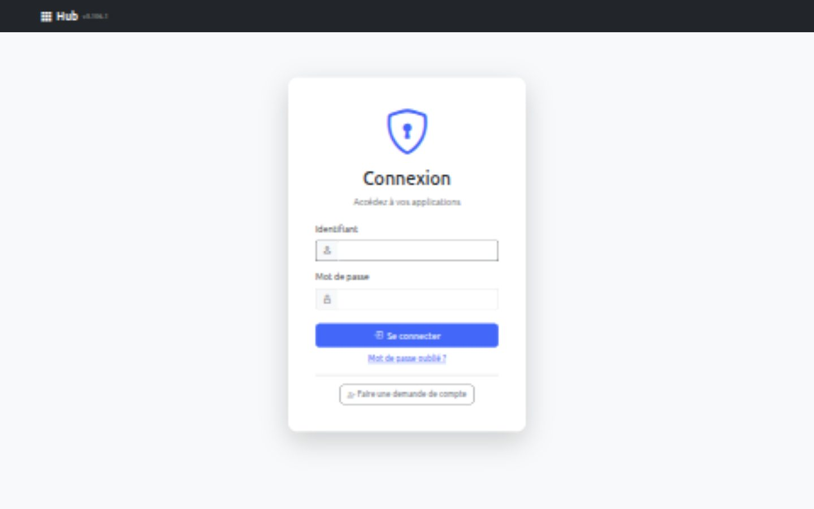
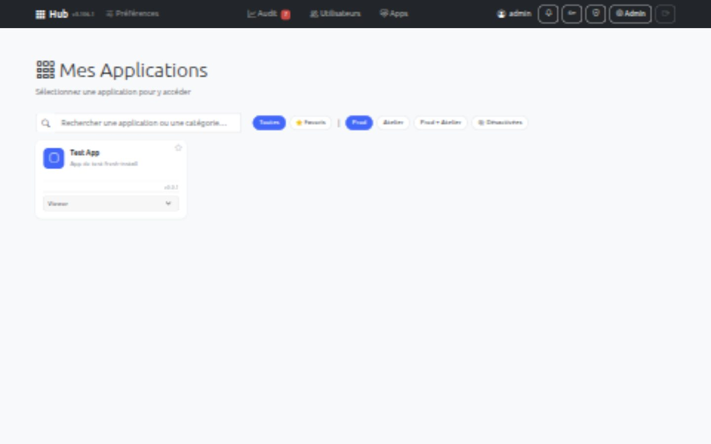
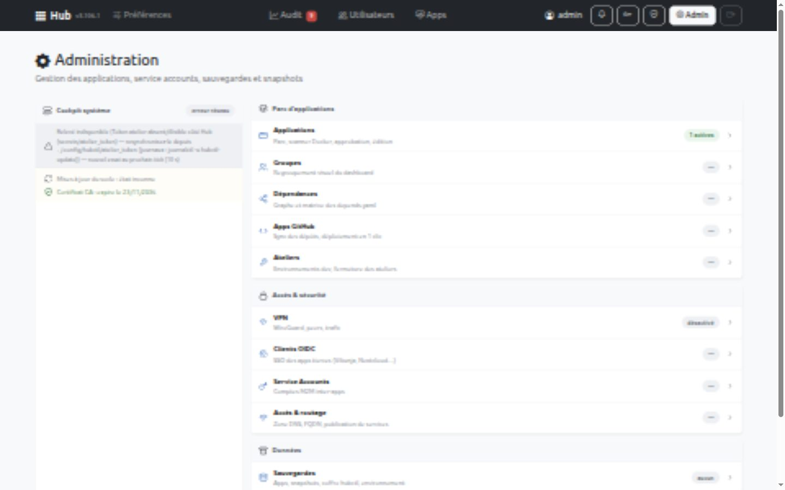
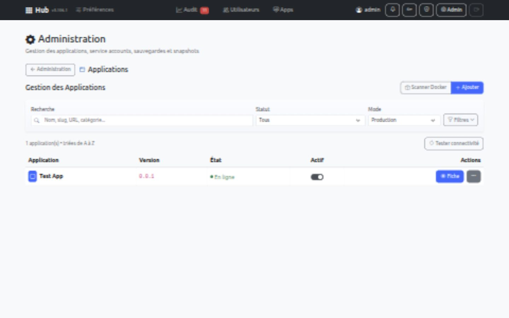

# POULIDOR — parc d'applications branchées sur un Hub d'authentification self-hosted

POULIDOR est un petit parc d'applications métier organisé autour d'un **Hub
d'authentification auto-hébergé** : SSO par tokens JWT signés RS256, PKI interne,
registre des applications, messagerie inter-apps, sauvegardes — l'alternative légère
et maîtrisée à Keycloak/Authentik, pensée pour une exploitation simple sur un serveur
unique.

Le parc se compose de sept dépôts, publiés ici en open source (AGPLv3 pour le cœur,
MIT pour le gabarit et le design system) :

| Dépôt | Rôle | Version |
|-------|------|---------|
| [`HUB`](https://github.com/poulidor-hub/HUB) | Le Hub : SSO, PKI, registre des apps, messagerie, sauvegardes, WireGuard |  |
| [`HUBsocle`](https://github.com/poulidor-hub/HUBsocle) | Socle versionné des applications (API fine branchée sur le Hub) |  |
| [`HUBapp-template`](https://github.com/poulidor-hub/HUBapp-template) | Gabarit d'application branchée sur le Hub (FastAPI + React) |  |
| [`HUBCSS`](https://github.com/poulidor-hub/HUBCSS) | Design system CSS/JS servi aux applications |  |
| [`hubctl`](https://github.com/poulidor-hub/hubctl) | CLI d'administration du parc (init, update, ateliers, coffre) |  |
| [`hub-mcp`](https://github.com/poulidor-hub/hub-mcp) | Serveur MCP pour piloter le Hub depuis un assistant IA (66 outils) |  |
| **POULIDOR** (ce dépôt) | Méta-dépôt : documentation, runbooks, scripts transverses |  |

---

## Aperçu

Installation de zéro sur une VM Debian 12 (reproductible, voir plus bas) :

| | |
|---|---|
|  |  |
| *Connexion SSO — tokens JWT RS256, PKI interne* | *Portail utilisateur : apps autorisées, favoris, rôles* |
|  |  |
| *Administration : parc, OIDC, VPN, sauvegardes, DNS* | *Registre des apps : approbation, état en direct (SSE)* |

> Les captures sont issues d'une installation de zéro reproductible par les
> mainteneurs : `scripts/test-fresh-install.sh` (VM Debian 12 éphémère, 17 vérifications).

## Installer un déploiement complet

Un déploiement POULIDOR = ce méta-dépôt (avec ses sous-modules) + vos applications
dans `APPS/` (hors git). Prérequis : un serveur Linux Debian/Ubuntu avec 2 Go de RAM —
l'installateur installe Docker, génère la configuration (`HUB_base/.env`, secrets, mot de
passe admin) et démarre le Hub. Installation validée de zéro sur VM Debian 12 (4 Go, 2 vCPU).

```bash
# 1) cloner le méta et ses composants
git clone --recurse-submodules https://github.com/poulidor-hub/POULIDOR.git
cd POULIDOR

# 2) installer le Hub (Docker compris) — idempotent, relançable sans risque
#    (le runner CI GitHub est en option : sudo ./install.sh --runner)
sudo ./install.sh

# 3) nommer la source officielle « upstream » (lecture seule)
git remote rename origin upstream

# 4) (recommandé) garder votre propre dépôt privé comme « origin »
git remote add origin git@<votre-git>:<votre-org>/POULIDOR.git
git push -u origin main

# 5) vos applications (hors git)
mkdir -p APPS

# 6) vérifier (ℹ = information, ✗ = problème avec son remède)
./hubctl doctor

# 7) installer une application — une seule commande
./hubctl app install <url-git-du-depot>
```

La configuration vit dans `HUB_base/.env` (généré par l'installateur) : ports,
`APP_WHITELIST_NETWORKS` (réseaux clients autorisés), OIDC, PKI… Le mot de passe admin
auto-généré y est noté (`ADMIN_PASSWORD`). Après toute modification de ce fichier : `./hubctl restart` — il
recrée les services concernés (un simple redémarrage des conteneurs ne relit pas le
`.env`, et `doctor` vous le signale). `doctor` marque « mise à jour disponible » comme
une information : sur un déploiement, la mise à jour d'un composant passe par celle du
méta (bloc « Mettre à jour » ci-dessous), jamais par un sous-module tiré au-delà de son
pointeur.

## Installer une application

Une application existante du parc (dépôt git) s'installe en une commande :

```bash
./hubctl app install <url-git-du-depot>
```

hubctl la clone dans `APPS/`, construit le socle s'il manque, lui fait allouer ports et
sous-réseau auprès du Hub, la démarre et l'approuve — votre mot de passe admin vous est
demandé si celui du `.env` a été changé ; sans mot de passe disponible, l'app est
installée et reste « en attente d'approbation » dans le Hub. Ses dépendances déclarées
dans `depends.yaml` sont installées d'abord (renseignez leurs dépôts dans
`seed-apps.yaml` si elles ne sont pas au registre du Hub). Plusieurs URL, ou un fichier
`seed-apps.yaml`, sont acceptés ; `--help` détaille les options. Pour créer une
application **neuve**, partez du gabarit
[`HUBapp-template`](https://github.com/poulidor-hub/HUBapp-template) (`INITIALISE.py`).

## Mettre à jour un déploiement

```bash
git fetch upstream
git merge --ff-only upstream/main
git submodule update --init --recursive
./hubctl update hub
./hubctl doctor
```

`--ff-only` refuse de mélanger vos éventuelles divergences locales : vous décidez.
**Ce dépôt public est en lecture seule pour les déploiements clients** — vos mises à
jour locales se poussent vers votre propre dépôt privé (`origin`), jamais vers
`poulidor-hub`. Un client qui fork un composant pour le personnaliser utilise
[`scripts/fork-remotes.sh`](scripts/fork-remotes.sh) pour réorganiser ses remotes
(origin = son fork, mises à jour tirées de la branche publique).

## Documentation

La documentation complète du parc vit dans ce dépôt : [`docs/guide-hub/`](docs/guide-hub/presentation.html)
(presentation, installation, hubctl, ateliers…), plus les guides embarqués dans chaque
composant (`HUB_base/docs/`, gabarit, hubctl).

## Organisation du dépôt

```
POULIDOR/
├── HUB_base/               ← sous-module : le Hub (FastAPI + vanilla JS + PostgreSQL)
├── HUBsocle/               ← sous-module : le socle applicatif (Python + Rust)
├── HUBapp_TEMPLATE_base/   ← sous-module : le gabarit d'application
├── HUBCSS/                 ← sous-module : le design system
├── hubctl_src/             ← sous-module : la CLI hubctl
├── hub-mcp/                ← sous-module : le serveur MCP
├── docs/                   ← documentation (guide-hub, runbooks, benchmarks)
└── scripts/                ← scripts transverses (migration, oss-guard, remotes…)
```

## Licences

- `HUB_base` et le socle : **GNU AGPLv3** — voir [`HUB_base/LICENSE`](HUB_base/LICENSE).
- Gabarit, design system, CLI, hub-mcp : **MIT**.
- Le nom « POULIDOR » et les logos ne sont pas couverts par ces licences.
