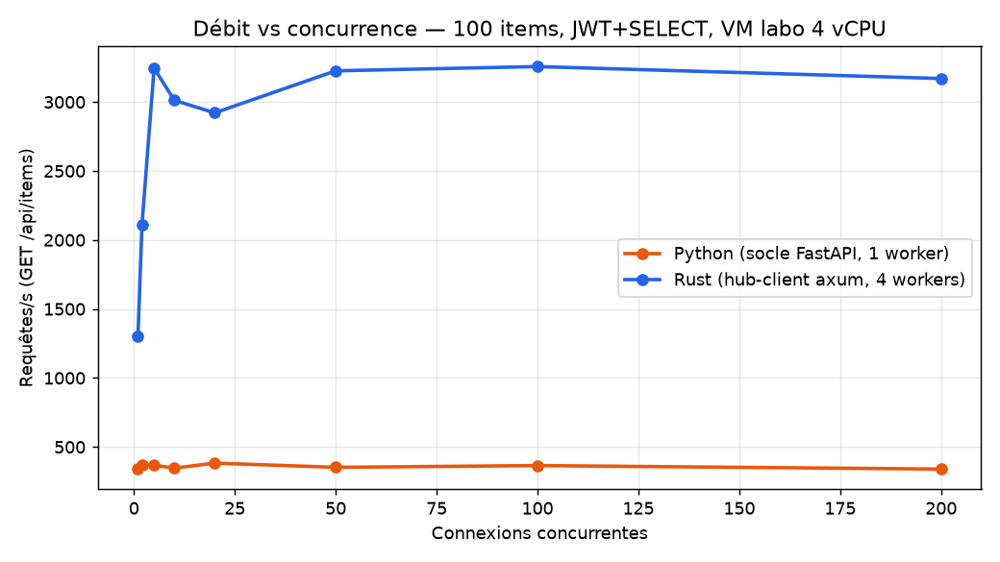
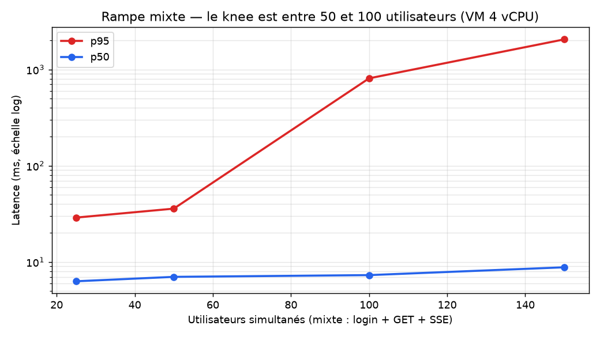

# Rapport de benchmarks POULIDOR — Novembre 2026

**Campagne complète : performances des templates · Installation · PRA/Backup · Charge du Hub**

| | |
|---|---|
| **Période** | 16 novembre 2026 |
| **Environnements** | Labo VM Debian 12 isolés (KVM/QEMU) — jamais la production |
| **Versions testées** | HUBsocle 2.37.x · hub-client 0.1.0 (Rust) · socle-app 2.36.x (Python) · HUB_base 3.92.x · hubctl (main) |
| **Documents détaillés** | [bench-rust-vs-python](bench-rust-vs-python-2026-11-16.md) · [bench-install-pra](bench-install-pra-2026-11-16.md) · [bench-hub-charge](bench-hub-charge-2026-11-16.md) |
| **Jeu de données** | CSV bruts + scripts de reproduction archivés dans le labo (`journal.md`) |

---

## 1. Synthèse exécutive

Trois campagnes de benchmarks ont été menées en conditions isolées et reproductibles sur la stack POULIDOR :

1. **Performances des deux templates d'application** (backend Python socle FastAPI vs backend Rust hub-client/axum) sur un workload métier identique.
2. **Chaîne opérationnelle et DR** : installation fraîche du serveur complet, sauvegarde/restauration d'applications, coffre chiffré du Hub, restauration PRA.
3. **Montée en charge du Hub** : logins simultanés, sessions authentifiées, connexions SSE tenues, rampe mixte — pour dimensionner les serveurs selon le nombre d'utilisateurs.

**Conclusions principales** :

- **Le template Rust délivre ×10 sur le workload métier authentifié** (débit et latence), validé à parallélisme égal, sur les écritures, et ×13,6 sur les gros payloads — au prix d'une image ×13,5 plus légère, d'une RAM au repos ×43 inférieure et d'un boot ×2,7 plus rapide.
- **Le template Python reste le choix rationnel pour le CRUD métier** : les vraies applications sont limitées par PostgreSQL, pas par le langage ; sa vélocité de développement et son accès natif au socle ne sont pas compensables.
- **La chaîne DR est rapide et prouvée** : serveur complet opérationnel en ~6 minutes depuis zéro, coffre chiffré complet en 551 ms, restauration PRA du Hub en 374 ms, backup/restauration d'app en secondes — avec **parité byte-level des formats entre les deux templates**.
- **Le Hub absorbe la charge sans jamais perdre une requête** : 200 logins simultanés traités en 11 s, ~237 rps authentifiées soutenues, 800 connexions SSE tenues sans aucun drop — avec un knee de saturation clairement identifié (~100 utilisateurs simultanés mixtes sur 4 vCPU).
- **Les tests ont eux-mêmes amélioré le parc** : 1 bug générateur (uuid manquant), 1 step manquant au harness d'installation, et 1 finding PRA sur le replay DB du coffre ont été découverts, mesurés et (pour deux d'entre eux) corrigés pendant la campagne.

---

## 2. Chiffres clés — prêts pour la vitrine

> Chaque figure est accompagnée du contexte obligatoire pour un usage honnête.

| # | Chiffre | Contexte d'usage |
|---|---|---|
| 🖥️ | **« Un serveur POULIDOR complet s'installe en ~6 minutes »** | VM 2 vCPU/4 Go : clone → install → Hub sain + login admin. +4 min pour les images socle et une app Python bootée. |
| 🔐 | **« Restauration PRA du Hub : 374 ms de traitement »** | Coffre chiffré de 60 Ko → CA, secrets JWT, `.env`, registre d'apps, utilisateurs restaurés (hors redémarrage des conteneurs). |
| 💾 | **« Backup + restauration d'une application : quelques secondes »** | 5 900 items : backup 82-190 ms, restore 2-5,6 s selon le backend. Formats identiques entre templates à l'octet près. |
| ⚡ | **« Le backend Rust multiplie le débit métier par 10 »** | Endpoint authentifié (JWT + SELECT), out-of-box : 371 → 3 883 rps, latence p50 ÷10. À parallélisme égal (1 worker) : ×9,9. |
| 📦 | **« Gros payloads : ×13,6 »** | Liste de 3 000 items (~650 Ko) : 22 → 293 rps. Débit binaire : 14 Mo/s → 192 Mo/s. |
| 🪶 | **« Empreinte divisée par 13,5 »** | Image API : 2,07 GB (Python) → 153 MB (Rust). RAM au repos : 73,8 MiB → 1,7 MiB. Boot : 1,4 s → 0,5 s. |
| 👥 | **« 200 logins simultanés traités en 11 secondes »** | IP distinctes (topologie LAN), hashing inclus. ≈18 logins/s par 4 vCPU. |
| 📊 | **« ~237 requêtes authentifiées/s soutenues, 0 erreur même saturé »** | Par 4 vCPU, endpoint DB-bound ; le Hub met en file au lieu de rejeter. |
| 🔔 | **« 800 connexions SSE simultanées, zéro drop »** | Mémoire stable (~185 MiB). Première limite : les file descriptors du conteneur (réglage, pas produit). |
| 📈 | **« Dimensionnement : 50 usagers simultanés → 2-4 vCPU ; 100 → 4-8 ; 300 → 8 + DB dédiée »** | Voir table complète §6.5. |

---

## 3. Méthodologie & environnement

### 3.1 Environnements

| Campagne | Support | Dimensionnement | Isolation |
|---|---|---|---|
| Templates (perf) | Labo VM Debian 12 KVM `perf-rust-vs-python` | 8 Go / 4 vCPU | Hub + 2 apps jumelles, aucune donnée réelle |
| Install/PRA | Labo VM + VM jetable du harness `test-fresh-install.sh` | 4 Go / 2 vCPU (profil « petit serveur client ») | Jamais la production |
| Charge Hub | Labo VM `perf-rust-vs-python` (Hub HUB_base) | 8 Go / 4 vCPU | 200 utilisateurs synthétiques |

### 3.2 Outils et protocole

- **HTTP** : ApacheBench 2.3, HTTP/1.1 sans keepalive, percentiles via CSV `-e` (précision 0,1 ms), ordre A/B/A/B, 3 runs par point (médiane), warmup systématique.
- **Utilisateurs** : générateur asyncio/aiohttp (logins, sessions authentifiées, connexions SSE tenues, rampe mixte), IP virtuelles distinctes (`X-Real-IP`) pour refléter la topologie LAN réelle.
- **Données** : seeds déterministes (100 / 3 000 / 5 900 items), mots de passe à hash réel (vérification CPU authentique).
- **Observabilité** : CPU/RAM conteneurs (`docker stats` échantillonnés), file descriptors (`/proc/1/fd`), tailles d'images, timestamps boot → santé 200.

### 3.3 Règle de lecture

Les **valeurs absolues sont VM-flavored** (vCPU partagés, générateur co-localisé, loopback). Les **ratios et coûts unitaires** sont les résultats transposables. Aucune donnée client, aucun passage en production.

---

## 4. Performances des templates — Rust vs Python

> Détail complet : [bench-rust-vs-python-2026-11-16.md](bench-rust-vs-python-2026-11-16.md)

### 4.1 Baseline (out-of-box : Python 1 worker, Rust 4 workers)

**GET /api/items** (JWT RS256/JWKS + SELECT owner-clausé, 100 items, failed=0) :

| Concurrence | Python p50 | Rust p50 | Python rps | Rust rps | Gain |
|---|---|---|---|---|---|
| 10 | 24,4 ms | 2,46 ms | 371 | 3 883 | ×10,5 |
| 50 | 128,4 ms | 12,3 ms | 370 | 3 730 | ×10,1 |
| 100 | 267,1 ms | 26,0 ms | 363 | 3 690 | ×9,8 |

**GET /api/health** (sans auth) : latence ÷3,3 à ÷3,7, débit ×3,3-3,5.

### 4.2 Calibration « workers » — le ×10 n'est pas un artefact

| Config (items, c=50) | p50 | rps | vs Python 1w |
|---|---|---|---|
| Python 1 worker (défaut) | 126 ms | 371 | 1 |
| Python 4 workers | 51 ms | 911 | ×2,5 |
| Rust 1 worker | 12,4 ms | 3 666 | **×9,9** |
| Rust 4 workers (défaut) | 12,3 ms | 3 806 | ×10,3 |

- Python scale mal (×2,5 pour 4× workers) ; **Rust mono-worker ≈ multi-worker** (+4 % — le goulot est la DB/la pile réseau, pas le langage).
- **py-4w perd ×4 contre rs-1w** : à configuration égale ou non, l'écart tient. *Note : les tableaux 4.1/4.2 proviennent de campagnes de tir distinctes (écart inter-tirs ≤ 2,5 %).*

### 4.3 Écritures et gros payloads

| Scénario | Python | Rust | Gain |
|---|---|---|---|
| POST = INSERT (c=50) | 448 rps, p50 ~107 ms | 4 010 rps, p50 ~11,7 ms | **×9,0** |
| Liste 3 000 items (~650 Ko, c=10) | 22 rps, p50 445 ms | 293 rps, p50 33 ms | **×13,6** — le POST unitaire est plus rapide que le GET de liste (sérialisation d'1 ligne vs 100) |
| Débit binaire (payload) | ~14 Mo/s | ~192 Mo/s | ×13,7 |

### 4.4 Ressources et cycle de vie

| | Python | Rust | Rapport |
|---|---|---|---|
| Image API | 2,07 GB | 153 MB | ×13,5 |
| RAM au repos (post-boot) | 73,8 MiB | 1,7 MiB | ×43 |
| RAM sous charge soutenue | ~83 MiB (stable) | ~23,5 MiB (stable) | ×3,5 |
| Boot API → santé 200 | ~1 410 ms | ~515 ms | ×2,7 |
| Chaîne de build | secondes (image socle préconstruite) | minutes (compilation) | avantage Python |

---

## 5. Installation, PRA, backup

> Détail complet : [bench-install-pra-2026-11-16.md](bench-install-pra-2026-11-16.md)

### 5.1 Installation fraîche (VM 2 vCPU / 4 Go — profil « serveur client »)

| Étape | T+ |
|---|---|
| VM Debian prête (boot + cloud-init) | +0,8 min |
| Clone récursif du parc | +1,2 min |
| **Hub installé et sain** | **+5,9 min** |
| Login admin opérationnel | +6,0 min |
| Images socle construites in-VM | +9,7 min |
| App Python bootée | +10,7 min |

### 5.2 Backup & restauration d'app — parité DR des deux templates

| Volumétrie | Étape | Python | Rust |
|---|---|---|---|
| ≈3 000 items (ZIP 88,6 Ko) | backup | 100 ms | 37 ms |
| | restore upsert | 2 721 ms | 820 ms |
| ≈5 900 items (ZIP 173,7 Ko) | backup | 190 ms | 82 ms |
| | restore upsert | 6 117 ms | 1 731 ms |
| | restore clear | 5 562 ms | 1 995 ms |

**Parité byte-level** : ZIP Python 88 589 o vs Rust 88 562 o — le même coffre restaurable dans les deux templates.

### 5.3 Coffre Hub et PRA

| Opération | Mesure |
|---|---|
| `hubctl vault backup` (3 `.env` + 12 secrets + CA + dump registry) | **551 ms** — coffre 60 Ko chiffrés |
| `hubctl vault restore` (sur serveur reconstruit) | **374 ms** — CA, secrets JWT/SA, `.env`, registre |
| Vérification identité | login avec les credentials du serveur d'origine : OK |

⚠ **Finding hubctl** : le replay DB de la restauration peut échouer en silence sur des conflits FK (pas de `ON_ERROR_STOP`, pas de post-vérification) — un dump pourtant sain peut n'être que partiellement rejoué. Recommandation : `ON_ERROR_STOP=1` + comptage de lignes post-restore. *Corrigé — hubctl 0.20.4 : ON_ERROR_STOP=1, comptage de lignes post-restore, rollback effectif, timeout proportionnel (déployé le 17/11/2026).*

### 5.4 Création d'app bout-en-bout (Hub restauré)

| Backend | Génération | Build | Total E2E (boot → connecté) |
|---|---|---|---|
| Python | 43 s | secondes | **≈86 s** |
| Rust | 43 s | 1 m42 s (deps) + 52 s (app) | **≈5 min** (1ʳᵉ compilation) |

---

## 6. Charge du Hub & dimensionnement

> Détail complet : [bench-hub-charge-2026-11-16.md](bench-hub-charge-2026-11-16.md)

### 6.1 Logins (pic matinal)

- **Anti-brute-force actif et calibré** : 5 logins / 60 s / IP (garde-fou sécurité voulu — une tempête mono-IP est bloquée par 429, c'est le comportement attendu).
- **Rafale réaliste** (200 postes distincts, 1 login chacun) : **200/200 authentifiés en 11,1 s** — ≈18 logins/s par 4 vCPU, plafond = hashing des mots de passe (CPU).
- Login isolé : p50 ≈ 10 ms.

### 6.2 Sessions authentifiées

**~237 rps soutenues** (plafond DB-bound), **0 erreur** jusqu'à 200 requêtes concurrentes ; p50 croît de 40 ms à 852 ms (mise en file, jamais de rejet).

### 6.3 Connexions SSE

**800/800 connexions tenues sans aucun drop** (60 s), FD hub-api 842/1024, mémoire ~185 MiB stable. La limite FD du conteneur (1024, réglage par défaut) est le premier mur.

### 6.4 Rampe mixte réaliste

| Utilisateurs simultanés | p50 | p95 |
|---|---|---|
| 25 | 6,3 ms | 29 ms |
| 50 | 7,0 ms | 36 ms |
| 100 | 7,3 ms | **808 ms** ← knee |
| 150 | 8,8 ms | 2 053 ms |

### 6.5 Table de dimensionnement

| Utilisateurs simultanés actifs | vCPU | RAM | Notes |
|---|---|---|---|
| ≤ 50 | 2-4 | 4-8 Go | Confort total (p95 < 40 ms) |
| 50-100 | 4-8 | 8 Go | Monter les FD du conteneur Hub |
| 100-300 | 8 + tuning DB | 8-16 Go | Workers uvicorn multiples, `/api/auth/me` est DB-bound |
| 300-1 000 | 16 + DB dédiée | 16 Go | FD Hub > 8 000 |

**Coûts unitaires mesurés (par 4 vCPU)** : ≈18 logins/s · ≈237 rps authentifiées · ≈230 Ko RAM par connexion SSE · 0 erreur même saturé.

---

## 7. Findings transverses — les tests ont amélioré le parc

| # | Finding | Statut |
|---|---|---|
| 1 | `uuid` manquant au Cargo.toml des apps rust générées (régression 2.37.0 — E0433 au premier build) | **Corrigé** — HUBsocle 2.37.1 / méta 0.85.2 |
| 2 | Harness fresh-install : image socle absente du docker VM → phase app impossible sur hôte propre | **Corrigé** — step `socle-build` ajouté, méta 0.85.5 |
| 3 | Hub : `vault restore` rejoue la DB partiellement et en silence (conflits FK sans `ON_ERROR_STOP`) | **Ticket à ouvrir** (`hubctl_src`) — dump coffre sain, replay manuel vérifié |
| 4 | Hub : garde-fou anti-brute-force login (5/min/IP) non configurable — peut mordre derrière un NAT/VPN agrégé | Ticket à considérer |
| 5 | Hub : FD conteneur hub-api à 1024 par défaut — premier mur SSE (>900 connexions) | Réglage compose à documenter |
| 6 | Harness : assertion `submodules -eq 5` périmée (6 sous-modules), timeout install 120 s trop court, buildkit flake | Dette documentée — chantier séparé |
| 7 | `/api/docs` (OpenAPI) non servi par le squelette Rust ; `cert_sync` et runner validation 20-checks absents v1 | Limites v1 documentées |

---

## 8. Recommandations d'usage et de dimensionnement

### 8.1 Choix de backend par app

| Profil d'app | Backend | Justification |
|---|---|---|
| Proxy, dataplane, transfert haut débit | **Rust** | ×10 débit, ×13,6 payload, empreinte minimale |
| Beaucoup d'instances / hosts contraints | **Rust** | 1,7 MiB repos, image 153 MB, boot 0,5 s |
| CRUD métier (exemple-app-2, exemple-app-16…) | **Python** (défaut) | DB-bound : le langage n'est pas le goulot ; vélocité + accès natif socle |
| Prototypes, apps courtes | **Python** | Vélocité, écosystème skills |

### 8.2 Dimensionnement serveur Hub

Voir table §6.5. Règles : ~230 Ko RAM par connexion SSE ; ~60 rps authentifiées par vCPU ; ~4-5 logins/s par vCPU ; monter les FD dès >800 SSE.

### 8.3 Garde-fous d'usage

- Les **ratios** sont transposables ; les **absolus** sont VM-flavored (cœurs partagés, générateur co-localisé).
- Le garde-fou login (5/min/IP) est voulu : vérifier la topologie d'accès (NAT/VPN agrégé) avant scale-up.
- Garder `make test-contract` à chaque release socle — c'est le filet de parité des deux backends.

---

## 9. Reproduction

- **Labo** : `scripts/lib/vm-lab.sh` — labo `perf-rust-vs-python` (conservé), journal complet dans `build/vm-lab/perf-rust-vs-python/journal.md`.
- **Scripts** : `~/campaign.sh` (templates), `~/hub-load.py` (charge Hub), `~/p1-app-backup.sh`, `~/pB2.sh`, `~/probe2.py` — CSV dans `~/campaign/`, `~/hubload/`.
- **Harness install** : `scripts/test-fresh-install.sh --keep` (rapports dans `build/fresh-install/runs/`).
- **Données** : `build/vm-lab/perf-rust-vs-python/results*/` (CSV) + `docs/performance/img/` (graphiques).

---

## Annexe A — Transparence des mesures

1. **Keepalive ab** : ~100 % de « failed » (fermetures idle) → protocole no-keepalive identique pour tous.
2. **Health « failed »** : écarts de Content-Length (timestamp/uptime variables), pas des erreurs — latences valides.
3. **Seed ITEMS_MAX** : noms de 200 chars rejetés (garde à 120) → phase B v1 invalidée, relancée à 100 chars.
4. **CPU sous charge** : non capturé — efficacité déduite des débits.
5. **Single-run** : courbe de saturation et sondes SSE ; les autres points = médiane de 2-3 runs.
6. **Worker defaults** : Rust 4 workers vs Python 1 worker = comparaison out-of-box des templates ; calibration §4.2 pour l'égalité.
7. **Collision de release 0.85.4/0.85.5** pendant la campagne (session parallèle) — re-numérotation propre, historique linéaire.

## Annexe B — Releases liées à la campagne

| Dépôt | Version | Contenu |
|---|---|---|
| HUBsocle | 2.37.0 → **2.37.1** | Variante Rust complète + fix uuid générateur |
| Méta POULIDOR | 0.85.1 → **0.85.5** | Pointeurs + skill `--backend rust` + fixes harness (socle-build in-VM) |
| APPS (labo) | perf-py, perf-rs, perf5-*, canary-rust | Apps de bench et canari Rust (gitigné méta) |
