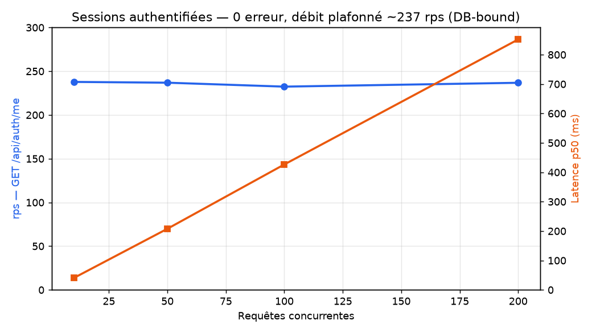
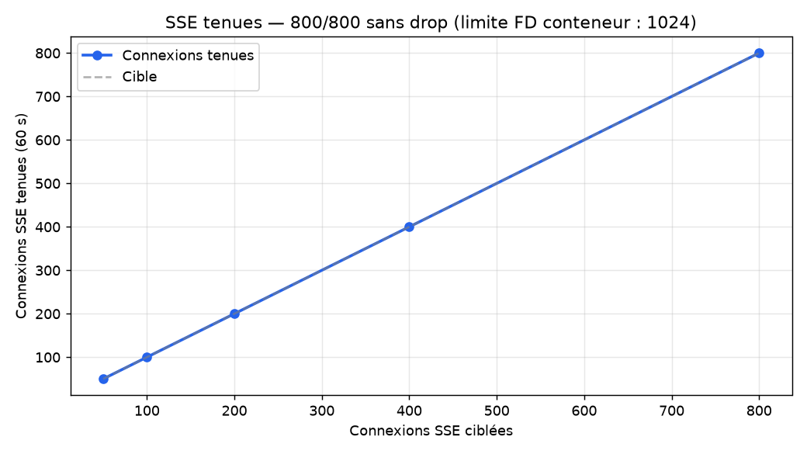
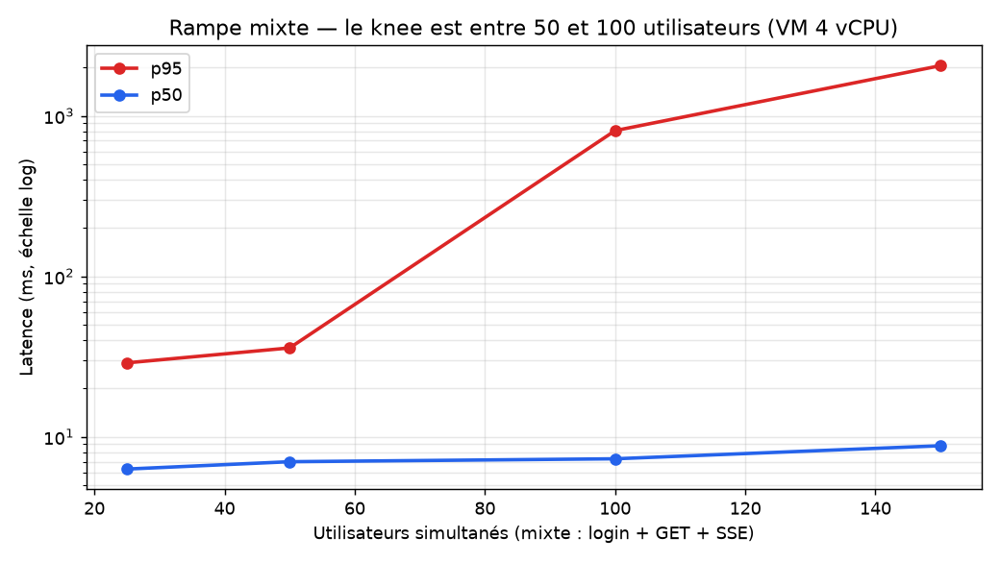

# Benchmark charge Hub — dimensionnement serveurs POULIDOR

**Date** : 16 novembre 2026 · **Cible** : Hub HUB_base 3.92.0 (labo VM 4 vCPU / 8 Go, générateur asyncio co-localisé — lire les ratios, les absolus sont VM-flavored)
**Protocole** : générateur asyncio/aiohttp, 200 utilisateurs synthétiques (hash réel), IP virtuelles distinctes (`X-Real-IP`) pour refléter la topologie LAN, 0 données réelles.

## S1 — Logins : le garde-fou anti-brute-force est actif et calibré

- **Anti-brute-force codé** : 5 logins / 60 s / IP (fenêtre glissante, en mémoire) — une tempête continue depuis une IP unique est bloquée par 429 (« Trop de tentatives… »). C'est un garde-fou de sécurité **par design**.
- **Rafale réaliste (200 postes distincts se connectant simultanément, 1 login chacun)** : **200/200 authentifiés en 11,1 s** (≈18 logins/s), p50 5,9 s · p95 10,8 s — le plafond est le **hashage des mots de passe** (CPU-bound), pas la DB.
- Login isolé : p50 ≈ 10 ms.

**Dimensionnement** : un pic matinal de 200 utilisateurs (LAN, IPs distinctes) est absorbé en ~11 s. Le hashing est le coût : ≈18 logins/s par 4 vCPU → 1 vCPU ≈ 4-5 logins/s.

## S2 — Sessions authentifiées (navigation)

| Concurrence | rps | p50 | p95 | p99 | Erreurs |
|---|---|---|---|---|---|
| 10 | 238 | 40 ms | 54 ms | 67 ms | 0 |
| 50 | 237 | 208 ms | 266 ms | 289 ms | 0 |
| 100 | 232 | 427 ms | 511 ms | 579 ms | 0 |
| 200 | 237 | 852 ms | 991 ms | 1031 ms | 0 |

**Débit plafonné à ~237 rps** quelle que soit la concurrence (variation inter-tirs ≤ 2,5 % — cohérente avec la loi de Little : c ≈ rps × latence à chaque palier) — goulot DB (`/api/auth/me` interroge la base à chaque appel), **zéro erreur même saturé** (le Hub met en file, il ne drop pas).

## S3 — Connexions SSE tenues (tableaux de bord ouverts)

| Cible | Tenues (60 s) | FD hub-api | Mémoire hub-api |
|---|---|---|---|
| 50 | 50 | — | — |
| 100 | 100 | — | — |
| 200 | 200 | — | — |
| 400 | 400 | — | — |
| 800 | **800** | **842 / 1024** | ~185 MiB (stable sur 60 s) |

- **800/800 connexions tenues, zéro drop** ; la première vraie limite est la **limite de file descriptors du conteneur (1024)** — à monter (ulimit/compose `LimitNOFILE`) pour >900 sessions SSE.
- Mémoire : ~185 MiB à 800 SSE, **stabilité parfaite** (aucune croissance = pas de fuite).

## S4 — Rampe mixte réaliste (login + GET périodique + SSE tenue)

| Utilisateurs simultanés | p50 | p95 | Erreurs | SSE tenues |
|---|---|---|---|---|
| 25 | 6,3 ms | 29 ms | 0 | 25 |
| 50 | 7,0 ms | 36 ms | 0 | 50 |
| 100 | 7,3 ms | **808 ms** | 0 | 100 |
| 150 | 8,8 ms | **2 053 ms** | 0 | 150 |

**Le knee est entre 50 et 100 utilisateurs simultanés** sur 4 vCPU (p95 explose, le p50 reste bas — le Hub met en file d'attente au lieu de rejeter).

## Table de dimensionnement (extrapolée des coûts unitaires mesurés)

| Utilisateurs **simultanés actifs** | vCPU recommandés | RAM recommandée | Notes |
|---|---|---|---|
| ≤ 50 | 2-4 | 4-8 Go | p95 < 40 ms, SSE < 100 → confort total |
| 50-100 | 4-8 | 8 Go | p95 commence à croître ; monter les FD conteneur Hub |
| 100-300 | 8 | 8-16 Go | multiplier les workers uvicorn + tuning DB (`/api/auth/me` est DB-bound) ; FD Hub > 2 000 |
| 300-1 000 | 16 + DB dédiée | 16 Go | répartir, DB sur host dédié, FD Hub > 8 000 |
| Pic de logins simultanés | ~1 vCPU / 5 logins/s | — | hashing CPU-bound ; un pic de 200 users ≈ 11 s |

**Coûts unitaires mesurés** (VM 4 vCPU, à diviser par le nombre de cœurs dédiés au Hub en prod) :
≈18 logins/s · ≈60 rps authentifiées par vCPU (237/4) · ≈230 Ko de RAM par connexion SSE · 0 erreur même en saturation.

## Caveats

1. Générateur co-localisé sur la VM (4 vCPU partagés avec le Hub) — les capacités réelles sur serveur dédié sont **supérieures** ; les coûts unitaires et le knee relatif sont les résultats.
2. Le rate-limit login (5/min/IP) est un garde-fou **voulu** : en déploiement NAT/VPN-agrégé, une même IP publique porte tous les users — le plafond de 5 logins/min/IP peut alors mordre sur un vrai pic matinal (voir config Hub pour ajuster).
3. La limite FD conteneur (1024) est un réglage par défaut, pas une limite du produit.
4. S3/S4 : mesures single-run ; S1/S2 : protocole stabilisé multi-paliers.
