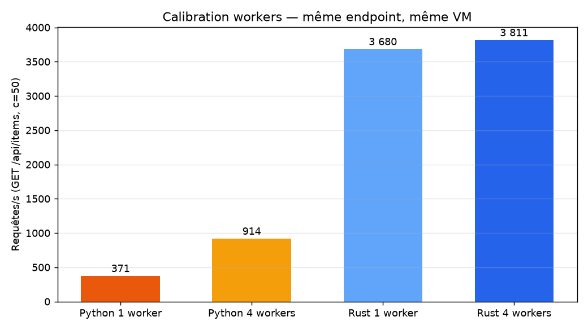
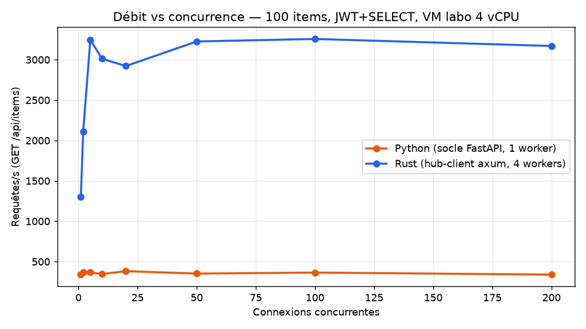
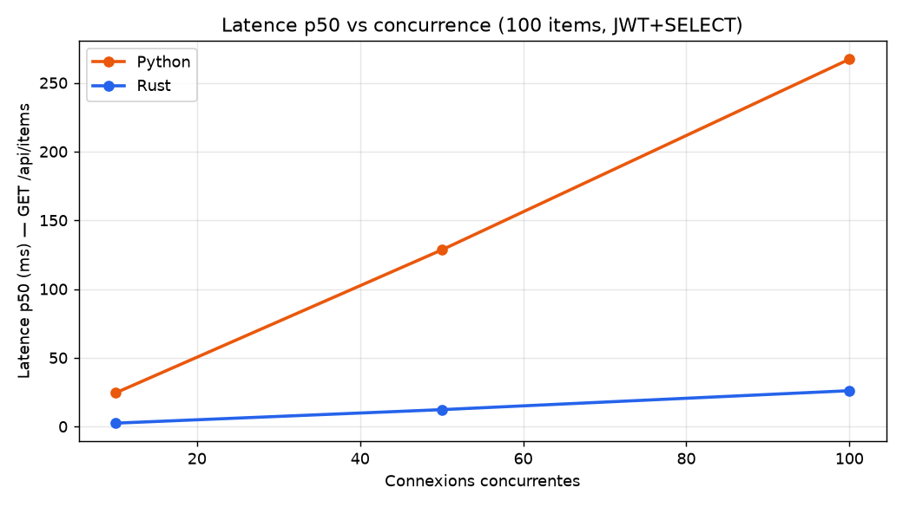

# Benchmark Rust vs Python — template Hub POULIDOR

**Date** : 16 novembre 2026 · **Environnement** : labo VM Debian 12 (`perf-rust-vs-python`, 8 Go / 4 vCPU, KVM), Hub HUB_base 3.92.0 isolé
**Apps comparées** : `perf-py` (socle FastAPI, image `poulidor/socle-api:2.37.0`) vs `perf-rs` (hub-client 0.1.0 / axum 0.8) — générées par INITIALISE v2, dialecte identique, même seed, même utilisateur
**Versions** : HUBsocle 2.37.x · hub-client 0.1.0

## Méthodologie

- **Protocole** : ApacheBench 2.3 (ab), HTTP/1.1 **sans keepalive**, percentiles via sortie CSV `-e` (précision 0,1 ms).
- **Ordre A/B/A/B** : py puis rs alternés, 3 runs par point, médiane reportée.
- **Workload** : `GET /api/health` (sans auth), `GET /api/items` (JWT Hub RS256/JWKS + SELECT owner, 100 items), `POST /api/items` (INSERT), gros payload (3 000 items ≈ 650 Ko), courbe de saturation c=1→200, mémoire sous charge 60 s.
- **Apps dans leur configuration par défaut** sauf calibration workers explicite.
- **Limites** : VM 4 vCPU (absolus VM-flavored — lire les *ratios*) ; ab mono-instance ; CPU sous charge non capturé.

## Résultats

### 1. Baseline — re-mesure session fraîche (défauts : Python 1 worker / Rust 4 workers)

**GET /api/items** (JWT + SELECT owner, 100 items, corps stable, failed=0) :

| Concurrence | Python p50 | Rust p50 | Python rps | Rust rps | Gain débit |
|---|---|---|---|---|---|
| 10 connexions | 24.4 ms | 2.46 ms | 371 | 3 883 | ×10.5 |
| 50 connexions | 128.4 ms | 12.28 ms | 370 | 3 730 | ×10.1 |
| 100 connexions | 267.1 ms | 26.07 ms | 375 | 3 659 | ×9.8 |

**GET /api/health** (sans auth ; latences valides, colonne « failed » d'ab exclue — artefact de longueur variable) :

| Concurrence | Python p50 | Rust p50 | Python rps | Rust rps | Gain débit |
|---|---|---|---|---|---|
| 10 connexions | 2.91 ms | 0.86 ms | 3 364 | 10 706 | ×3.2 |
| 50 connexions | 14.77 ms | 3.87 ms | 3 348 | 11 956 | ×3.6 |
| 100 connexions | 29.94 ms | 8.17 ms | 3 300 | 10 950 | ×3.3 |

### 2. Calibration « workers » — l'expérience clé

> Note : les tableaux 4.1 (baseline) et 4.2 (calibration) proviennent de **campagnes de tir distinctes** — les écarts inter-tirs sur un même palier sont ≤ 2,5 % (variation normale en VM virtualisée).

| Config | p50 (c=50) | rps (c=50) | rps (c=100) |
|---|---|---|---|
| Python 1 worker (défaut) | 129.5 ms | 371 | 364 |
| Python 4 workers | 51.1 ms | 914 | 919 |
| Rust 1 worker | 12.35 ms | 3 680 | 3 583 |
| Rust 4 workers (défaut) | 11.87 ms | 3 811 | 3 726 |

**Lecture** :
- Python scale avec les workers mais **×2,5 seulement** pour 4× workers (371 → 914 rps).
- **Rust mono-worker ≈ Rust multi-worker** (3 680 vs 3 811 rps, +4 %) — un seul thread tokio sature le goulot réel (DB + pile réseau), pas le langage.
- **À configuration égale, l'écart tient** : ×9.9 en 1w-vs-1w, ×4.2 en 4w-vs-4w. Et **py-4w perd encore ×4.0 contre rs-1w** : le ×10 n'est pas un artefact de parallélisme.

### 3. Gros payload (liste de 3 000 items ≈ 650 Ko)

| Concurrence | Python rps | Rust rps | Gain | Python p50 | Rust p50 |
|---|---|---|---|---|---|
| 10 | 22 | 290 | ×13.3 | 444 ms | 33 ms |
| 20 | 21 | 316 | ×14.8 | 922 ms | 57 ms |

Débit binaire effectif : Python ≈ **14 Mo/s**, Rust ≈ **192 Mo/s** (293 rps × 656 986 o ; plafond VM/loopback probable côté Rust).

*Note : le POST unitaire est plus rapide que le GET de liste à c=50 parce qu'il écrit une ligne et sérialise une réponse minuscule, là où le GET sérialise et transfère 100 items — le coût de sérialisation JSON dépasse le coût d'écriture d'une ligne.*

### 4. Écritures (POST = INSERT PostgreSQL)

À c=50 : Python **450 rps** (p50 ~107 ms) vs Rust **4 049 rps** (p50 ~11,7 ms) — **×9.0 sur les écritures**, le goulot PostgreSQL étant commun aux deux.

### 5. Courbe de saturation

| Concurrence | Python rps | Rust rps | Gain |
|---|---|---|---|
| 1 | 340 | 1 304 | ×3.8 |
| 5 | 368 | 3 245 | ×8.8 |
| 20 | 383 | 2 921 | ×7.6 |
| 100 | 365 | 3 257 | ×8.9 |
| 200 | 339 | 3 170 | ×9.3 |

Python est **dès c=1** à son plafond (~350-385 rps, 1 worker saturé) — la latence croît linéiquement (2,7 ms → 583 ms à c=200). Rust monte jusqu'à un plateau ~3 200 rps (c≥20, goulot DB/réseau) et reste ×3,8 même en **série pur** (c=1).

### 6. Mémoire sous charge soutenue (60 s à c=50)

| | Python | Rust |
|---|---|---|
| RSS au repos (post-boot) | 73,8 MiB | 1,7 MiB |
| RSS sous charge (stable) | ~83 MiB | ~23,5 MiB |
| Croissance sur 60 s | aucune | aucune |

### 7. Cycle de vie

| | Python | Rust | Rapport |
|---|---|---|---|
| Image API | 2,07 GB | 153 MB | ×13,5 |
| Boot API → santé 200 | ~1 410 ms | ~515 ms | ×2,7 |
| Chaîne de build | seconde(s) (image socle préconstruite) | minutes (compilation, image rust:1 ~1,5 Go) | avantage Python |

## Lecture & recommandations

- **Le ×10 est robuste** : il survit à la calibration workers (×9,9 à parallélisme égal), se retrouve sur les écritures (×9) et sur les gros payloads (×13,6). Il mesure le surcoût du framework + interpréteur par requête, pas la base de données.
- **Le terrain de Rust** : proxy/dataplane, transfert haut débit, payloads volumineux (×13,6), beaucoup d'instances (RAM), hosts contraints, redémarrages de flotte (boot ×2,7).
- **Le terrain de Python** : CRUD métier (les vraies apps sont DB-bound — le bench mesure le framework, pas la logique métier), vélocité de développement, accès natif au socle (alignement immédiat à chaque release), écosystème de skills/diagnostics du parc, chaîne de build triviale.
- **Découvertes de campagne** : Rust ne tire AUCUN bénéfice de ses 4 workers sur ce workload (mono-worker ≈ multi-worker) ; py-4w (×2,5 seulement) reste 4× derrière rs-1w.
- **Défaut générateur trouvé par le bench** : `uuid` manquant au Cargo.toml des apps rust générées (régression 2.37.0) — corrigé en HUBsocle 2.37.1 / méta 0.85.2 pendant la campagne.

## Annexe — artefacts de mesure (transparence)

1. **`ab -k`** (keepalive) : ~100 % de « failed » (fermetures idle serveur) → protocole no-keepalive, identique pour les deux backends.
2. **« Failed requests » sur /api/health** : écarts de Content-Length (timestamp/uptime variables), pas des erreurs.
3. **Phase B v1** : seed 200 chars rejeté par ITEMS_MAX (120) → invalidée, relancée (B2, 100 chars, 650 Ko vérifiés).
4. **CPU sous charge** : non capturé — efficacité par cycle déduite des débits.
5. **Absolus VM-flavored** : lire les ratios, pas les valeurs brutes.
6. **Phase D** : 1 run par point (courbe) ; autres phases = médiane de 3.

## Reproduction

Labo : `vm-lab.sh ssh perf-rust-vs-python` — `~/campaign.sh` (campagne), `~/bench.sh` (baseline) ; CSV `~/campaign/` + `results/`. Journal : `build/vm-lab/perf-rust-vs-python/journal.md`.
